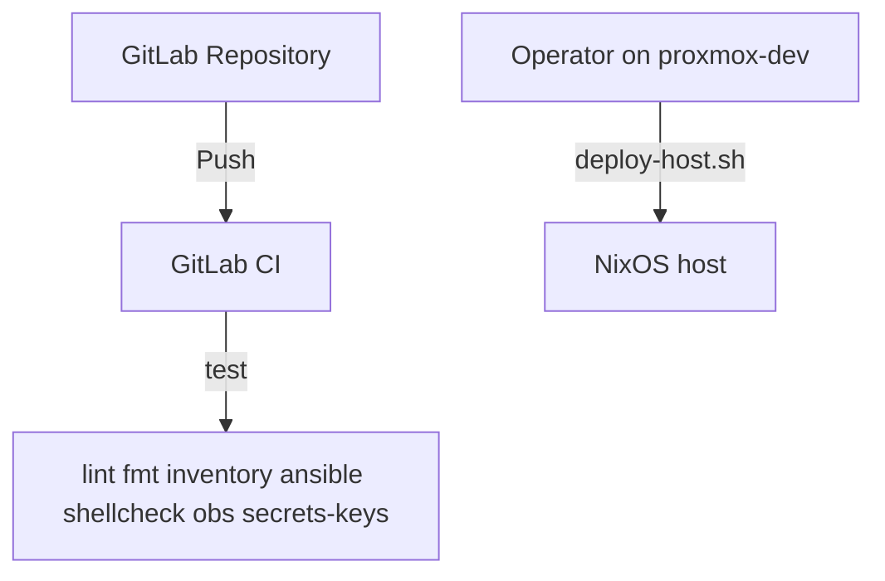

# Deployments

This document describes how the `nixos-fleet` configuration is verified and
deployed to target hosts.

## Deployment Architecture

Production activation builds on the native builder and `nix copy`s the
closure with `deploy-rs`, then `switch-to-configuration`. Hosts substitute
from `cache.nixos.org`. Attic is removed
([adr/2026-11-03-decommission-attic.md](adr/2026-11-03-decommission-attic.md)).

GitLab CI does not build or deploy. It only runs the lint gate. The
operator activates the three NixOS hosts (`xcloud-caddy`,
`xcloud-postgres`, `gaming`) from `proxmox-dev`
([adr/2026-11-05-ci-lint-only.md](adr/2026-11-05-ci-lint-only.md)).



## Operator commands

```bash
make lint
make fmt-check
make check-inventory
make ansible-lint                                # ansible/ + fleet.debian_guest
make changed-hosts                               # toplevels that differ from BEFORE (default origin/main)
make deploy-host HOST=xcloud-caddy               # build + nix copy + switch (on proxmox-dev)
make deploy-proxmox-host                         # Ansible: Proxmox VE hypervisor (not NixOS)
make deploy                                      # production fleet including gaming
make deploy-gaming                               # same path, gaming only
make bench-jellyfin-io                           # 4K Jellyfin I/O bench on proxmox-applications-debian
make jellyfin-library-audit                      # read-only NFO / path audit on that guest
make router-status                               # log in to the LAN router from proxmox-dev
make reboot-router                               # reboot it on request (`ROUTER_ARGS=--dry-run|--force`)
```

## deploy-rs Configuration

Targets are defined inside the `deploy.nodes` attribute in
[flake.nix](../flake.nix).

Nodes are constructed by a `mkNode` helper so these settings are declared
once rather than repeated per host:

- `hostname`: The MagicDNS Tailscale host name
- `sshUser`: `root`
- `sshOpts`: ControlMaster multiplexing plus `IdentitiesOnly` and the repo
  `ssh/fleet_known_hosts`
- `path`: The compiled system profile from `nixosConfigurations.<hostname>`
- `magicRollback`: `true` by default
- `remoteBuild`: `true` by default; hosts that set `remoteBuild = false`
  still compile on the builder when using `deploy-host.sh`

## CI/CD Pipeline

The GitLab CI configuration is defined in
[.gitlab-ci.yml](../.gitlab-ci.yml). GitHub
[`.github/workflows/lint.yml`](../.github/workflows/lint.yml) mirrors the
same gate. GitLab is CI of record
([adr/2026-11-05-ci-lint-only.md](adr/2026-11-05-ci-lint-only.md)).

### Test job

One job, always. `resource_group: proxmox-dev-nix` so it does not overlap
other Nix evals on the 12 GiB builder:

- [`scripts/lint.sh`](../scripts/lint.sh) (`nix flake check --all-systems --no-build`)
- `make fmt-check` (`nix fmt -- --ci`)
- [`scripts/check-inventory.sh`](../scripts/check-inventory.sh) (incl. Debian guest ⊆ inventory)
- [`scripts/ansible-lint.sh`](../scripts/ansible-lint.sh) (roles + playbook syntax-check)
- [`scripts/check-jellyfin-xml.sh`](../scripts/check-jellyfin-xml.sh)
- [`scripts/shellcheck.sh`](../scripts/shellcheck.sh)
- [`scripts/check-obs-config.sh`](../scripts/check-obs-config.sh) (promtool + amtool + dashboard jobs via `.#ci-tools`)
- [`scripts/check-secrets-keys.py`](../scripts/check-secrets-keys.py) (required key names; no decrypt)
- `make test-router-reboot` (pure helpers; no live router)
- `nix build .#packages.x86_64-linux.jellyfin-io-bench` on the GitLab builder
- `live-promql` job (`allow_failure`): scheduled/manual only; `make check-live-promql`

No select stage, no child pipeline, no deploy jobs. `SSH_PRIVATE_KEY` is
not used by CI.

## Proxmox hypervisor (Ansible)

The VE host is not a flake target. Apply it with `make deploy-proxmox-host`
from [`ansible/`](../ansible/). See
[services/proxmox-host.md](services/proxmox-host.md) and
[adr/2026-08-31-proxmox-ansible.md](adr/2026-08-31-proxmox-ansible.md).
Lint it with `make ansible-lint` (also covers `fleet.debian_guest`).

## Operator machine

Edits land on the Darwin checkout. **Deploys run on
`root@proxmox-dev`.** The fleet is x86_64 only; `rpi4` is decommissioned
and there is no aarch64 host. Do not `make deploy` from the laptop store or
from `gaming`.

```bash
rsync -az --delete --exclude='.git/' --exclude='result' --exclude='.direnv/' \
  /Users/alex/code/nixos-fleet/ root@proxmox-dev:/root/nixos-fleet-deploy/
ssh -A root@proxmox-dev 'bash -s' << 'EOF'
set -euo pipefail
export PATH="/run/current-system/sw/bin:/nix/var/nix/profiles/default/bin:$PATH"
cd /root/nixos-fleet-deploy
./scripts/deploy-host.sh <host>
EOF
```

`proxmox-dev` has no root deploy key. `ssh -A` forwards the operator agent
so `nix copy` and `switch-to-configuration` can hop to the target. Plain
`ssh` fails with `Permission denied (publickey)`.

`--exclude='.git/'` means the copy is a path flake: every file on disk is
visible (including untracked). A `nix` eval **in this git checkout** only
sees tracked files — `git add` new Nix/Go/Python that a module references
or lint fails.

## Local vs GitLab

| | Local | GitLab |
|---|---|---|
| Nix | already installed on proxmox-dev | `nixos/nix` image + `.#ci-tools` |
| SSH | operator keys + `ssh/fleet_known_hosts` | not used (no deploy jobs) |
| Gate | `make ci` | `make ci` in `test` |
| Deploy | `deploy-host.sh` on proxmox-dev | none |

A green pipeline is not a license to deploy. GitHub Actions mirrors the
gate and has no tailnet.

## Scripts

| Script | Make target | Notes |
|---|---|---|
| [scripts/lint.sh](../scripts/lint.sh) | `make lint` | `flake check --all-systems --no-build` |
| [scripts/ansible-lint.sh](../scripts/ansible-lint.sh) | `make ansible-lint` | both Ansible trees; Galaxy deps; offline |
| [scripts/check-inventory.sh](../scripts/check-inventory.sh) | `make check-inventory` | Makefile ↔ Nix; calls debian-inventory |
| [scripts/check-debian-inventory.sh](../scripts/check-debian-inventory.sh) | (via `check-inventory`) | Debian guests ⊆ `fleet.inventory.hosts` |
| [scripts/check-jellyfin-xml.sh](../scripts/check-jellyfin-xml.sh) | `make check-jellyfin-xml` | well-formed XML under apps role; **in CI** |
| [scripts/shellcheck.sh](../scripts/shellcheck.sh) | `make shellcheck` | `scripts/*.sh`; **in CI** via `.#ci-tools` |
| [scripts/check-secrets.sh](../scripts/check-secrets.sh) | `make check-secrets` | age key decrypt; **not CI** |
| [scripts/check-secrets-keys.py](../scripts/check-secrets-keys.py) | `make check-secrets-keys` | required key names; **in CI**; no decrypt |
| [scripts/check-mimir-rules.sh](../scripts/check-mimir-rules.sh) | `make check-mimir-rules` | hygiene + promtool on committed `rules.yaml` |
| [scripts/check-alertmanager-config.sh](../scripts/check-alertmanager-config.sh) | (via `check-obs-config`) | `amtool check-config` on committed `alertmanager.yml` |
| [scripts/check-obs-config.sh](../scripts/check-obs-config.sh) | `make check-obs-config` | promtool + amtool (+ prom syntax); **in CI** via `.#ci-tools` |
| [scripts/changed-hosts.sh](../scripts/changed-hosts.sh) | `make changed-hosts` | toplevel outPath vs `BEFORE` (default `origin/main`); `--all` |
| [scripts/deploy-host.sh](../scripts/deploy-host.sh) | `make deploy-host HOST=` | deploy-rs from builder store; skip switch if toplevel matches |
| [scripts/nix-develop.sh](../scripts/nix-develop.sh) | | wrapper around `nix develop` |
| [scripts/update-known-hosts.sh](../scripts/update-known-hosts.sh) | `make update-known-hosts` | from a trusted workstation `known_hosts` |
| [scripts/run-router-reboot.sh](../scripts/run-router-reboot.sh) | `make router-status`, `make reboot-router` | [runbook](runbooks/router-reboot.md) |
| [scripts/jellyfin-library-audit.sh](../scripts/jellyfin-library-audit.sh) | `make jellyfin-library-audit` | read-only; SSH to proxmox-applications-debian |

`make edit-secrets HOST=` / `make updatekeys` for sops. Ansible
(`make deploy-proxmox-host`) is not Nix; see
[services/proxmox-host.md](services/proxmox-host.md).

## Rollback

Every activation leaves a NixOS generation on the host. To walk one back,
or to recover a host that stopped answering SSH, see
[runbooks/rollback.md](runbooks/rollback.md). `make reboot-all` iterates
`PROD_HOSTS` and is a reboot, not a rollback.
